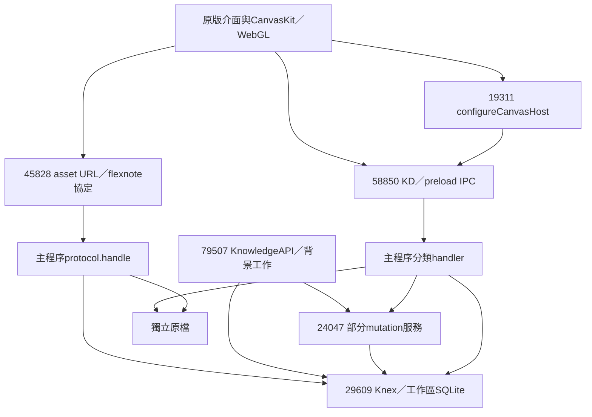

# 保留原庫的版本化快照架構與最小原型

日期：2026-10-30。本版依最新要求取代「只在退出後快照」與「每代重複附件」提案。保留FlexNote原schema、Knex及CanvasKit；OneDrive只作檔案運送，不追蹤上傳進度。本輪只讀調查及隔離原型，沒有修改原版程式、設定或正式資料。

## 結論與完成界線

**保留Knex 3.1.0＋sqlite3 5.1.7＋SQLite 3.44.2可行；隨附native Backup API已在9個私人資料庫副本完成備份與回建。** 完整DB影像保存歷史、索引頁、ID與引用，無需重寫原資料庫或白板引擎。

自寫隔離原型已實作共享不可變assets、唯一snapshot／parent、掃描分類、載入前保護目前修改及例外回復。11項自動測試通過。**尚未整合原版Ctrl+S、10分鐘timer、編輯器flush、全應用寫入屏障、快照GUI或真實OneDrive。** 不能把合成測試的flush callback當作正式編輯器已安全保存的證明。

完整需求需要小幅的宿主／生命週期整合；單靠外部copy工具無法確保仍在編輯器記憶體的內容已落盤。白板renderer、LOD、裁切、Knex查詢及既有schema都不是替換對象。

## 9個SQLite資料庫的角色

| 別名 | 用途／狀態 | 表數 | migration數 | 已讀主要內容 | journal |
|---|---|---:|---:|---|---|
| main.db | 全域工作區catalog及原版同步衝突歸檔 | 5 | 6 | spaces有8筆；syncConflictArchive；另有migration/sequence表 | DELETE |
| W0 | 已移至垃圾桶的工作區 | 88 | 82 | 所查卡片／白板／files為0，仍有schema及其他狀態 | DELETE |
| W1 | 已移至垃圾桶的工作區 | 88 | 82 | 同上，不代表整個檔案可任意刪除 | DELETE |
| W2 | 已移至垃圾桶的工作區 | 88 | 82 | 同上 | DELETE |
| W3 | 有主要資料的有效工作區 | 91 | 87 | 1955卡、994卡實例、37板、724 files、374正文歷史、41白板歷史 | DELETE |
| W4 | 已移至垃圾桶的工作區 | 88 | 82 | 所查主要內容為0 | DELETE |
| W5 | 已移至垃圾桶的工作區 | 88 | 82 | 所查主要內容為0 | DELETE |
| W6 | 已移至垃圾桶、較舊schema的工作區 | 49 | 58 | 所查主要內容為0，沒有新版白板歷史表 | DELETE |
| W7 | 有效但所查主要內容為空的工作區 | 91 | 87 | 所查卡片／板／files為0 | DELETE |

W0–W7按db_*.sqlite3檔名排序；完整ID映射僅存私人flexnote-nine-db-inventory.json。八個檔案ID皆對應main.db的spaces.id。工作區表內的spaceId／物件ID及main.db的syncConflictArchive.spaceId是邏輯關聯，不是跨SQLite檔案的強制外鍵。工作區庫內雖留spaces表，但所查均0列，不是全域catalog。

不能用安裝版本推定所有工作區migration一致；不能只拷W3而遺失其catalog，也不能為載入一個工作區直接覆蓋其他工作區的main.db。首版保留所有歷史，六個trashed庫亦未清除。

## 主要資料流與保留邊界



傳輸有集中入口，連線有集中物件，但資料存取未全部通過單一DAL：卡片9174、標籤29130、附件18291、sections589、Mindmap32428均有直接Knex；內部API不一定經renderer IPC。附件二進位另走flexnote協定的Range/MIME串流。故新增屏障要涵蓋完整mutation、背景工作及附件寫入，不能只攔一條IPC或只等一條SQL結束。

白板66597有CanvasEngine，15166有可視索引，10764為元件、67259為hydrate、48626接持久化callbacks，19311提供host adapter。已讀到LOD/culling/picture cache與可視圖像載入，具體offset與hash見FEATURE_MATRIX。這些全部保留。

## 編輯器延遲與Ctrl+S的正確保存邊界

已確認Lexical update listener有200ms合併；34883 adapter另有約300ms節流及pending timer；它們是不同層，不應機械相加成固定等待時間。48626的onNodeContentChange路線可直接呼叫KD(updateNoteCard)再更新UI，沒有把該Promise完整向外return。28862只是正文歷史快照策略，不是寫入完成屏障。

正式整合須建立可等待的flush協定：

1. 向相關編輯視窗／editor registry要求flush；讀取當前Lexical state、清掉待送存timer，處理尚在中文組字的內容，不強制切斷IME。
2. 追蹤所有送出的持久化Promise，包括原本fire-and-forget的KD呼叫；等待主程序transaction成功提交後才回flushAck。
3. 暫停新的工作區mutation入口，等待已進行的整個業務操作、索引／內部job及附件寫入結束；不能在多步tag或Mindmap命令中間取快照。
4. 固定此次capture revision，製作DB副本及對應資產版本清冊；發布完成才更新lastCapturedRevision。捕捉之後的新編輯仍為dirty，不可一併清掉。

目前沒有證明原版已提供可直接使用的全域flush/barrier。原型以合成callback驗證await順序，正式整合仍是後續工作。

## 快照排程與管理

- Ctrl+S：flush後若有未備份變更才發布。
- 每10分鐘：有變更才嘗試；請求合併到單一序列，不重入、不堆積多份相同快照。
- 正常退出：flush並補必要快照，保存失敗不能默默顯示成功或丟掉修改。
- 背景／休眠前：best effort且可合併；不阻擋OS休眠、不承諾在強制斷電前完成，恢復後補查dirty。
- 手動重新掃描本機snapshots與assets；不查OneDrive上傳狀態，不建立共享latest指標。

第一版原型以完整DB副本hash＋附件hash判定變更；純重複保存已測不新增版本。它還會把索引等DB位元組變化保守視為變更，且每次需做候選副本／hash。正式接入應以完整分類的userDataRevision作快速dirty判定，不能只用mtime，也不能漏掉AI對話、屬性或附件變更。

## snapshots與共用assets

```text
OneDrive/<vault>/
  snapshots/<workspaceId>/<snapshotId>/
    database.sqlite3
    manifest.json
  assets/<hash前兩碼>/<sha256>.<ext>
```

每份manifest有workspaceId、snapshotId、sourceComputerId、createdAt、parentVersionId、DB hash/size、schema fingerprint/migration、app/SQLite版本及資產fileId→logicalPath→objectPath/hash/size。資產原檔不轉碼；同hash／ext重用一次，新內容有新hash，舊snapshot仍指向舊物件。所有物件與版本不可覆寫，第一階段不做GC。

本機current base及fingerprint只存在各機localRoot/state.json，**不放OneDrive**。掃描按parent鏈判斷current、newer-in-chain、older-in-chain、branch；缺parent為unknown-lineage。未完成／本次驗證失敗獨立標示。時間僅展示，不決定分支勝負。

## 資料庫與附件的一致性

Backup API保證單SQLite庫快照，不包含尚在editor的內容、附件或另一個庫。最小原型在呼叫者提供的barrier內，先flush，製作DB副本，再按副本files表收集並hash原檔、對照manifest覆蓋全部files引用，最後發布manifest；任何失敗都不更新local base、不覆寫前版。未完成目錄或孤立asset留存待檢查。

正式版應在附件匯入／改寫時保留不可變版本及修訂記錄，使barrier只需固定DB/capture revision與資產對應；重I/O於worker進行。初次baseline及尚未版本化的附件不能先解除屏障再任意讀現用路徑。外部useLink／遠端URL須先明確收集，否則不標完整；原型直接拒絕useLink。

catalog metadata、該workspace相關syncConflictArchive與工作區DB須在同一capture邊界讀取。還原只套用選定工作區catalog，保留其他工作區和各機登入／路徑設定。**原型尚未接入正式main.db catalog載入；9庫實驗是逐庫私人副本驗證，不是已完成跨庫原子擷取。**

## 本機下載驗證、分支與載入

不需要知道上傳完成。接收端只看本機：manifest可解析、DB／所有必要asset存在且實體可讀、大小與hash相符、schema／版本可接受、DB files引用與清冊吻合，才允許載入。READY／目錄存在不足；OneDrive可能先送manifest再送DB/asset。每次rescan重新驗證，驗證失敗不刪資料也不永久判死。

原型已模擬manifest先到、asset未到、placeholder可用性callback及壞hash；**未接Windows真實placeholder屬性／真實OneDrive測試**，沒有以模擬當實機完成。

A、B由V1分出V2-A、V2-B時，各自UUID永不共寫，兩份均保留；使用者選分支後，下一份快照parent就是選定版本，不以新時間戳消滅另一支。

載入流程：flush目前修改→必要時先建立保護快照→重新驗證目標與所有asset→staging重建DB＋原檔→關閉相關SQLite連線／workers／媒體handle→切換→重開並重新hydrate→更新本機base。失敗回復完整舊工作副本。正式首版建議受控重新啟動工作區／程式完成重開，避免所有快取／多個Knex pool熱替換風險；使用者仍在運行中選版本與啟動載入。

原型已有closeWorking/reopenWorking介面及staging/rollback，例外後回復已測；突然斷電後自動重放load-intent、真實多視窗與多磁碟切換尚未完成，不是可直接部署的熱載入器。

歷史與跨板引用隨原DB保留，不重新分配ID。相容的FTS／vec0索引先沿用完整快照；若需重建，應在副本或重開後走原版重建／backfill路線，只處理已確認可重建的索引表及jobs，不能清掉AI對話、課程、來源內容或歷史。正式驗收須再核對原版搜尋結果、索引完成狀態、PDF定位及跨板共享；目前已驗FTS合成查詢與真實DB索引頁保存，未驗原版vec0重建。

## WAL與3.44.2

9庫實測journal_mode均DELETE，初始化只見busyTimeout及vec0載入，沒有發現切WAL設定；close()卻有PASSIVE checkpoint呼叫，該呼叫本身不代表目前在WAL。SQLite官方指出3.44.2屬WAL-reset受影響範圍，條件是WAL＋多連線同時write/checkpoint，修正於3.51.3並回補3.44.6／3.50.7。見[官方WAL-reset說明](https://sqlite.org/wal.html)。

本輪不改正式journal模式、不升級原版engine、不新增checkpoint。原型對WAL來源明確拒絕線上備份；不能以只升級外部helper或壓力測試未重現來宣布原版3.44.2安全。日後若使用WAL，須確認所有可write/checkpoint連線皆受序列化／修補引擎控制。

## 相較明碼重建與後續

保留DB讓歷史、查詢、索引與跨視窗通知沿用原路徑；新增的主要成本是flush/barrier、版本清冊、資產版本、掃描與安全載入。重建Markdown/JSON權威儲存還要替換大量直接Knex與語義，已無必要。完整Markdown＋語義JSON匯出仍保留作資料自主保障，尚未完成全格式轉換器。

原版核心未公開source/build及開源license（官方README已確認）；自寫原型不重用其程式碼，正式hook接入方式與可維護授權仍需確認。此次沒有patch原版，亦不需要重寫CanvasKit或資料庫。
