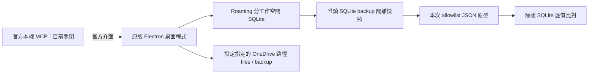

# 架構評估與關鍵決策

日期：2026-10-30。證據分級及位置見 FEATURE_MATRIX.md。這是 M0/M1 技術評估，未批准全面實作。

## 結論與 A–F 回答

**A：能保留多少？** 採官方 MCP／外部匯出伴隨工具時，原版安裝及白板核心全部繼續使用，但明碼檔案只能先作鏡像，尚不能成為原版的權威儲存來源。沒有證據能量化「替換儲存後仍保留多少核心」。不以百分比猜測。

**B：只替換儲存與同步，其他功能可正常運作嗎？** 尚未成立。已確認資料把內容與白板實例分離，這對 adapter 有利；但沒有取得官方 storage plugin／完整 importer 契約。交易、通知、Undo、索引、歷史、附件解析器可能跨層耦合，不能因為資料能轉換就宣稱 UI 仍正常。官方說明同步可選，表示可本機使用，不表示可刪除同步程式碼而無影響。

**C：哪些需重寫？** 若官方提供可替換儲存邊界或合作修改：新增明碼權威 store、交易／恢復、檔案同步協定、版本備份及索引重建；調整資料存取呼叫、附件 URI、載入／存檔通知與 Mindmap 鍵盤控制。渲染器、排版、編輯器可作保留目標，但須契約測試後才能確認。若沒有此邊界：A 只能新增伴隨工具；C 的 UI、編輯器整合、白板、資料適配必須自行實作或採可合法使用的元件，工程量顯著較高。Electron/Chromium 的授權不涵蓋 FlexNote 專有程式。

**D：如何防白板退化？** 保留原版為對照，使用相同硬體、相同 100/300/500 混合卡片及固定操作，分別量測冷／暖載入、輸入延遲分布、幀時間、記憶體與長時間成長；原版沒有基準前不批准替代渲染器。細則見 TEST_REPORT.md。

**E：成本與風險最低？** 先 A（官方擴充＋明碼鏡像／可驗證匯出）收斂資料格式，再優先洽詢官方可否提供 storage adapter 或授權合作。A 目前不能滿足完整 P1/P2，因此只能作低風險起點。B 必須先取得授權依據及可測的邊界；C 是確定無法保留核心後的備案，不預設重寫。

**F：下一步？** 開發「完整資料與附件的無損匯出／驗證器」，在隔離工作空間驗證官方重新匯入與來源定位。先補 MCP 唯讀連線、類型覆蓋與附件清冊，再作一張混合白板 roundtrip。這是資料自主的必要基礎，也能直接淘汰不可靠的改造方式。尚未開始 M2。

## 方案比較（I：工程判斷）

| 面向 | A 官方整合／伴隨工具 | B 隔離副本局部修改 | C 獨立相容程式 |
|---|---|---|---|
| 原版功能 | 原版繼續運作；擴充範圍有限 | 潛在高保留，未證實 | 初期低，須逐一重建 |
| 工程量 | 最低；全量雙向鏡像則上升 | 邊界清楚可中等，混淆耦合則高 | 最高 |
| 白板性能風險 | 低；背景匯出仍需限制 I/O | 中高，通知／載入改動可能影響 | 高，必須先做對照基準 |
| 資料架構 | 原庫仍權威，不能冒充明碼自主 | 可實現明碼權威，但需一致性設計 | 可自主設計，遷移語義仍難 |
| 維護、更新 | 官方 API 版本相容測試 | 可能每版重做 patch、簽章與升級風險 | 自行維護所有功能 |
| 授權 | 官方 API 及使用者內容 | 未確認，條款有限制 | 自有程式／逐件核查開源授權 |
| 決策 | 現在推薦的驗證起點 | 暫不進入實作 | 後備，不先做 |

## 已知本機結構及未知邊界

這張圖表示已見資料路徑，不表示已復原程式呼叫圖。白板 Canvas/DOM/WebGL、虛擬化、LOD、空間索引、快取、圖片/PDF 延遲載入、狀態框架與 Mindmap 排版相依關係均 U。官網的自訂引擎說明無法填補這些未知。REA ASAR 分析在 Windows 可用但本次未執行；沒有因工具存在而推定核心可合法重用。

目前附件設定根目錄已在 OneDrive，主體資料庫卻在 Roaming；不能只把現有資料夾當成完整可攜資料庫，也不能直接把運作中的 SQLite 放進 OneDrive 宣稱完成 P2。

## 若取得官方支援，建議的最小模組化單體

UI／白板 renderer 僅依賴記憶體 read model 與命令介面；命令／Undo 層操作 Cards、BoardInstances、Edges、Mindmaps、Tags、Assets 領域；repository 介面由明碼 store 實作；本機 SQLite 僅作可重建索引。外部檔案變更先經驗證與 conflict import，再一次更新 read model，不讓檔案 watcher 直接改 UI。

卡片是跨板共享內容；instance 有自己的 ID、boardId、objectId、位置及樣式。白板元素不必全是卡片。Mindmap 的選取／編輯／組字狀態機獨立於布局。附件用穩定 assetId 與相對路徑，顯示名稱可改，不能用可變檔名作唯一主鍵。

儲存與同步詳細契約見 DATA_FORMAT.md。不要另建微服務，不預選 React/Vue 或替代渲染框架。

## 必須先解除的障礙

- 官方授權或可適用例外的依據、可支援的儲存介面；本評估不推定法律例外成立，也未聯絡官方。
- MCP 目前停用，未拿到實際工具 schema 或完整性差異。
- 官方 importer 是否保留所有 ID、歷史、塊引用、屬性與附件；不是「可匯入 Markdown」便足夠。
- 100/300/500 白板原版基準、兩台真實 OneDrive 裝置、完整附件及 UI 恢復測試。

故 M0 已得到足以選擇下一步的評估，但內部核心調查仍有明列未知；M1 的資料可讀性子驗證通過，原版核心局部替換的 Go gate **未通過**。
